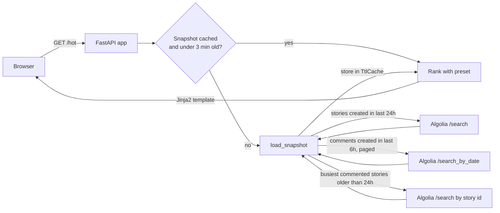

# HN Browser

A personal Hacker News front end that orders stories by what is hot *now*: recent
comment activity, comment totals, points, and points per hour. Hacker News's own
front page decays by age; this does not.

Data comes only from the public [Algolia Hacker News Search API](https://hn.algolia.com/api).
The HN website is never scraped, and every story links back to its HN thread.
Personal, non-commercial use.

## Presets

| Tab | Ranking |
|---|---|
| Hot now | Comments posted in the last 6 hours, grouped by story |
| Discussed today | Stories from the last 24 hours by total comments |
| Top today | Stories from the last 24 hours by points |
| Rising | Stories from the last 24 hours by points per hour of age (one hour floor) |

## How a request is served



All four tabs rank the same cached snapshot, so switching tabs costs no API calls.
If a refresh fails the cache keeps serving the last good snapshot.

## Run locally

```sh
uv sync
uv run uvicorn hn_browser.app:app --reload
```

Then open <http://127.0.0.1:8000>.

## Test

```sh
uv run pytest
```

Tests never touch the network: the ranking functions are pure, and the API client
is tested through an httpx mock transport.

## Deploy to Render

`render.yaml` describes a free-tier web service. Connect the repository in the
Render dashboard as a Blueprint and it deploys from `main`. The free instance spins
down after 15 idle minutes; the first request afterwards takes about a minute.

## Layout

```
hn_browser/
  ranking.py    pure ranking functions over Story records
  hn_client.py  Algolia HN Search API client
  snapshot.py   one combined fetch of stories and recent comments
  feed.py       presets, stats, and Feed assembly
  cache.py      single-value TTL cache with stale-on-error
  format.py     display helpers (domain, age, HN links)
  app.py        FastAPI routes and wiring
  templates/    Jinja2 page
  static/       stylesheet and theme toggle
tests/          pytest, parameterised where there are several cases
```
