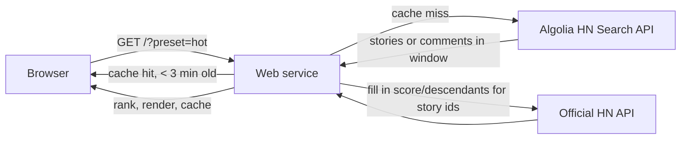

# Hacker News Browser: requirements brief

Date: 2026-11-03. Status: agreed scope for v1, not yet implemented.

## Goal

A personal Hacker News front end that orders stories by what is hot *now*, using
upvotes, comment count and recency, instead of HN's own age-decayed ranking.
Used by Dan, occasionally shown to one or two others. Non-commercial.

## Constraints (verified 2026-11-03)

- Data comes only from the official HN API (MIT, no rate limit) and the Algolia
  HN Search API (10,000 requests/hour/IP). Never fetch HTML from news.ycombinator.com;
  YC's Terms of Use forbid scraping the site and commercial reuse of its content.
- Every story and comment count links back to HN.
- Deploys to Render's free web service tier: 512 MB, spins down after 15 min idle,
  750 instance-hours/month. No cron (minimum $1/month), no free Postgres beyond 30 days.
  So v1 has no database and no scheduled job.

## v1 scope

Fixed ranking presets, chosen by tabs:

| Preset | Source query | Order |
|---|---|---|
| Hot now | comments created in the last 6h, grouped by `story_id` | comments in window, desc |
| Discussed today | stories created in last 24h | `num_comments` desc |
| Top today | stories created in last 24h | `points` desc |
| Rising | stories created in last 24h, points per hour of age | points / age_hours desc |

Each row shows: rank, title (links to the article), domain, points, comment count
(links to the HN thread), age, and the window-specific number that put it there
(e.g. "39 comments in the last 6h").

Out of scope for v1: accounts, voting, read tracking, keyword filters.
In-app comment reading was added on 2026-11-03 as `/story/{id}` via Algolia's
items endpoint. "Recently viewed" and similar come later and will need either
localStorage (per browser) or a small store.

## Data flow

Rankings are computed on demand and cached in process memory for a few minutes.
A spun-down service therefore costs nothing; the first visit after idle pays a
cold start plus one or two API calls.

## Stack

Python 3.12, FastAPI, Jinja2 templates, httpx for API calls, uv for packaging.
Server-rendered HTML with no front-end build step. Tests with pytest, parameterised
for the ranking functions, with recorded API fixtures so tests never hit the network.
Deployed to Render via a `render.yaml` blueprint.

## Theme

Borrows the Map Tappers design system (https://maptap-ljym.onrender.com):

- Dark by default, light toggle stored in localStorage via `data-theme` on `<html>`.
- Tokens: `--bg #0a0c0e`, `--panel #12161b`, `--ink #eef2ee`, `--accent #c8f135`
  (lime), `--gold/--silver/--bronze` for ranks 1 to 3, `--radius 14px`.
- Fonts: Anton (display, uppercase hero), Hanken Grotesk (body), JetBrains Mono
  (numbers and metadata).
- Structure: sticky blurred nav with pill tabs and a theme button, a hero with a
  small uppercase tag line and a row of stat tiles, then the ranked list.

Stat tiles for the hero: total comments in the window, hottest story's comment
count, highest points today, stories above 100 points today.
